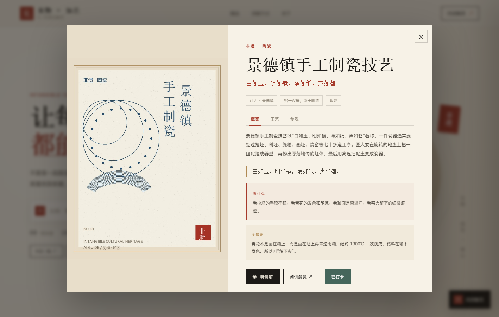
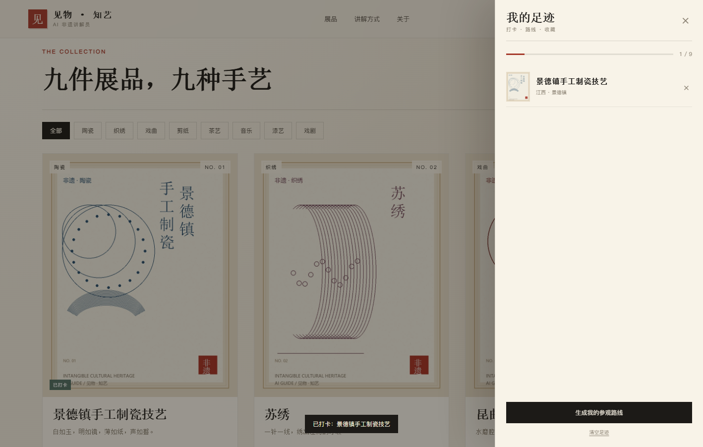

# 见物 · 知艺：AI 非遗讲解员

一个可以直接运行的非遗展馆 AI 讲解员原型。它把 9 项非遗展品拆成可检索的知识库，观众可以点开一件展品听讲解、问问题；回答会带知识来源，找不到依据时会明确说“不确定”。

## 1. 项目亮点

- **9 件非遗展品**：景德镇制瓷、苏绣、昆曲、中国剪纸、西湖龙井、龙泉青瓷、侗族大歌、扬州漆器、皮影戏。
- **RAG 知识库**：16 篇讲解词、54 个知识片段，先检索再回答，答案附来源。
- **混合检索**：向量相似度 + 关键词重合度，专有名词和工艺细节更稳。
- **展品路由**：问到“苏绣”“青花”“龙井”等关键词时，自动定位到对应展品知识库。
- **语音讲解**：调用浏览器中文语音朗读展品介绍和回答（推荐 Edge/Chrome）。
- **详情三视图**：概览 / 工艺 / 参观，工艺步骤用时间线展开。
- **个人化体验**：打卡、我的足迹、参观路线生成、今日一物随机讲解。
- **语音交互**：浏览器中文朗读 + 语音输入（支持的浏览器）。
- **移动端适配**：手机宽度下自动变成单列布局，聊天面板全屏。
- **零外部依赖**：前端原生 HTML/CSS/JS，不依赖 CDN；后端 H2 内存库，开箱即跑。
- **可选大模型**：配置 OpenAI 兼容 API Key 后，使用真实 embedding + 大模型生成；不配置也能演示。

## 2. 最快运行

要求：JDK 17 或更高版本。

项目根目录已经带好打包后的 jar：

~~~bash
cd feiyi-guide
java -jar feiyi-guide.jar
~~~

或者双击 start.bat（Windows）。

启动后打开：

~~~text
http://localhost:8081
~~~

健康检查：

~~~text
http://localhost:8081/api/health
~~~

如果 8081 被占用，可以换端口：

~~~bash
java -jar feiyi-guide.jar --server.port=8082
~~~

## 2.1 接入 DeepSeek

项目已经按 OpenAI 兼容协议接好 DeepSeek：

- Base URL：https://api.deepseek.com
- 模型：deepseek-chat
- 接口：/chat/completions
- API Key：由你本机输入，不写进代码

### 一键启动

1. 到 https://platform.deepseek.com 申请 API Key。
2. 双击项目根目录的“启动DeepSeek版.bat”。
3. 按提示粘贴 Key，回车。
4. 等待约 15 秒，浏览器打开 http://localhost:8082。

DeepSeek 版使用 8082 端口，可以和 8081 的本地版同时运行。

如果启动器同目录存在 deepseek-key.txt，会自动读取，不需要每次输入。该文件只放在本机，不要提交到仓库或发给别人。

### 回答引擎标记

AI 回答旁边会显示一个小标记：

- DeepSeek：这次回答由 DeepSeek 生成
- AI：这次使用本地知识库兜底

如果 Key 无效、余额不足或网络不通，系统会自动回退到本地抽取式回答，不会让页面报错。

### 为什么不用 DeepSeek embedding

DeepSeek 目前没有公开的 embedding 接口，所以项目配置为：

~~~yaml
app:
  llm:
    embedding-enabled: false
~~~

知识库检索使用本地哈希向量 + 关键词重合度，解决“找得到”的问题；DeepSeek 负责“讲得好”的生成部分。这样只需要一个 DeepSeek Key，不需要额外的 embedding Key。

### 命令行方式

~~~bash
java -jar feiyi-guide.jar --spring.profiles.active=deepseek --server.port=8082 --app.llm.api-key=你的Key
~~~

## 3. 从源码构建

~~~bash
cd backend
mvn -DskipTests package
java -jar target/feiyi-guide-1.0.0.jar
~~~

要求 Maven 3.9+、JDK 17+。

## 4. 目录结构

~~~text
feiyi-guide/
├── feiyi-guide.jar              打包后的可运行程序
├── start.bat                    Windows 一键启动
├── start.sh                     macOS/Linux 一键启动
├── README.md
├── docs/
│   ├── 项目说明.md              项目目标、技术方案、答辩要点
│   └── preview-*.png            页面预览图
└── backend/
    ├── pom.xml
    └── src/main/
        ├── java/com/feiyi/
        │   ├── exhibit/         展品实体与接口
        │   ├── chat/            RAG、向量库、大模型客户端
        │   ├── admin/           知识库管理接口
        │   └── DataInitializer  展品与知识库初始化
        └── resources/
            ├── application.yml
            └── static/          前端页面、样式、脚本、展品图
~~~

## 5. 页面与交互

### 页面预览

### 首页
- 展品卡片、类别筛选、搜索式提问入口
- 点击卡片打开讲解详情

### 展品详情
- 展品图、类别、产地、年代、简介、工艺看点
- “听讲解”：调用浏览器中文 TTS 朗读
- “问讲解员”：打开对话并带入当前展品上下文

### AI 讲解员
- 支持自由提问，也提供推荐问题
- 回答下方显示知识来源，可点击回到展品
- 找不到依据时明确提示，不编造
- 支持 #detail-1、#chat 深链接，方便演示

## 6. 知识库与 RAG

### 6.1 数据流

~~~text
展品/讲解词
  -> 按段落切块
  -> embedding（有 Key 用模型，无 Key 用本地哈希）
  -> 内存向量库
  -> 用户提问
  -> 混合检索 Top-K
  -> 拼接上下文
  -> 大模型生成 / 抽取式兜底
  -> 答案 + 来源
~~~

### 6.2 配置大模型

编辑 backend/src/main/resources/application.yml：

~~~yaml
app:
  llm:
    base-url: https://api.openai.com/v1
    api-key: 你的Key
    model: gpt-4o-mini
    embedding-model: text-embedding-3-small
  rag:
    top-k: 4
    min-score: 0.15
~~~

- base-url 可替换为 DeepSeek、通义、智谱等 OpenAI 兼容网关。
- 不填 api-key 时，使用本地哈希向量 + 抽取式回答，仍然可以完整演示检索和来源。
- 更换 embedding 模型后需要重启，启动时会自动重建知识库向量。

### 6.3 新增知识

调用管理接口（演示项目未加管理员鉴权）：

~~~bash
curl -X POST http://localhost:8081/api/admin/documents   -H "Content-Type: application/json"   -d "{"exhibitId":1,"title":"青花料的来源","source":"扩展资料","content":"青花使用含钴颜料，经高温烧成后呈蓝色。"}"
~~~

重建向量：

~~~bash
curl -X POST http://localhost:8081/api/admin/reindex
~~~

## 7. 主要接口

| 方法 | 路径 | 说明 |
|---|---|---|
| GET | /api/health | 健康检查，返回展品和知识片段数量 |
| GET | /api/exhibits | 展品列表，可加 ?category=陶瓷 |
| GET | /api/exhibits/{id} | 展品详情 |
| GET | /api/categories | 类别列表 |
| POST | /api/chat/ask | 提问，body 为 question 和 exhibitId |
| GET | /api/admin/documents | 知识库文档列表 |
| POST | /api/admin/documents | 新增知识文档 |
| POST | /api/admin/reindex | 重建知识库向量 |

提问返回示例：

~~~json
{
  "code": 0,
  "message": "ok",
  "data": {
    "answer": "青花之所以呈现蓝色，是因为画坯使用含钴的颜料……",
    "needHuman": false,
    "confidence": 0.23,
    "sources": [
      { "exhibitId": 1, "title": "景德镇：一件瓷器的七十二道工序" }
    ]
  }
}
~~~

## 8. 数据与配置

默认使用 H2 内存数据库，重启数据重置，适合演示。表由 JPA 自动创建，首次启动自动写入 9 件展品和 16 篇讲解词。

如果要使用 MySQL：

1. 建库：

~~~sql
CREATE DATABASE feiyi DEFAULT CHARACTER SET utf8mb4 COLLATE utf8mb4_unicode_ci;
~~~

2. 修改 application.yml：

~~~yaml
spring:
  datasource:
    url: jdbc:mysql://localhost:3306/feiyi?useUnicode=true&characterEncoding=utf8&serverTimezone=Asia/Shanghai&useSSL=false
    username: root
    password: 你的密码
    driver-class-name: com.mysql.cj.jdbc.Driver
  jpa:
    hibernate:
      ddl-auto: update
~~~

依赖里已经包含 MySQL 驱动。

## 9. 演示脚本（3 分钟）

1. 打开首页，说明“9 件展品、16 篇讲解词、54 个知识片段”。
2. 点开“景德镇手工制瓷”，切到“工艺”页看时间线，再点“听讲解”。
3. 在对话框问：“青花瓷的蓝色从哪里来？”
4. 指出回答下方的来源：“景德镇：一件瓷器的七十二道工序”。
5. 再问：“苏绣的双面绣难在哪里？”展示展品路由。
6. 打卡后打开“我的足迹”，生成一条参观路线；再问一个知识库外的问题，展示“不编造”。
7. 最后说明技术闭环：知识库 -> 混合检索 -> 生成 -> 来源追溯。

## 10. 答辩时可以强调

**社会效益**
- 让观众从“看展品”变成“读懂展品”，降低展馆讲解资源压力。
- 为小展馆、校园非遗展、线上展馆提供低成本讲解方案。

**技术难度**
- 不是简单套聊天框，而是 RAG 知识库、混合检索、展品路由、来源引用和兜底策略。
- 有 Key 时走真实 embedding + 大模型；无 Key 时仍有可运行的本地兜底。

**创新点**
- “一展品一知识库”的细粒度讲解。
- “讲解 + 追问 + 来源”的闭环。
- 语音朗读与上下文带入，接近真实讲解员体验。

## 11. 已知边界

- 本地哈希向量不是语义模型，复杂同义问题可能检索不准；配置 embedding 模型后效果更好。
- 浏览器 TTS 依赖系统中文语音；没有中文语音时会使用默认语音或无声。
- 管理接口未加鉴权，仅用于演示，生产需要管理员登录和权限控制。
- 展品图为项目生成的示意海报，不是真实文物照片；正式展出请替换为有授权的图片。